<picture><source media="(prefers-color-scheme: dark)" srcset="assets/dark/header-v1.svg"/>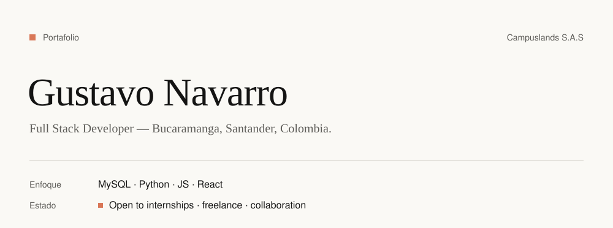</picture>
<a href="https://gustavoadolfonavarropacheco.vercel.app/"><picture><source media="(prefers-color-scheme: dark)" srcset="assets/dark/link-portfolio.svg"/></picture></a><a href="https://gustavoadolfonavarropacheco.vercel.app/Gustavo_Navarro_CV.pdf"><picture><source media="(prefers-color-scheme: dark)" srcset="assets/dark/link-resume.svg"/></picture></a><a href="https://www.linkedin.com/in/gustavo-adolfo-navarro-pacheco-876b06356/"><picture><source media="(prefers-color-scheme: dark)" srcset="assets/dark/link-linkedin.svg"/></picture></a><a href="mailto:adolfonavarro0212@gmail.com"><picture><source media="(prefers-color-scheme: dark)" srcset="assets/dark/link-email.svg"/></picture></a>
<picture><source media="(prefers-color-scheme: dark)" srcset="assets/dark/s01.svg"/>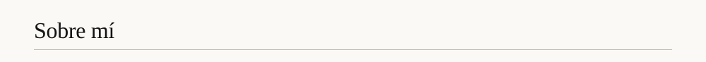</picture>
<picture><source media="(prefers-color-scheme: dark)" srcset="assets/dark/whoami.svg"/></picture>
<picture><source media="(prefers-color-scheme: dark)" srcset="assets/dark/s02.svg"/>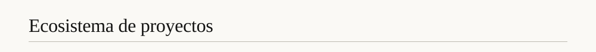</picture>
<picture><source media="(prefers-color-scheme: dark)" srcset="assets/dark/ecosystem.svg"/>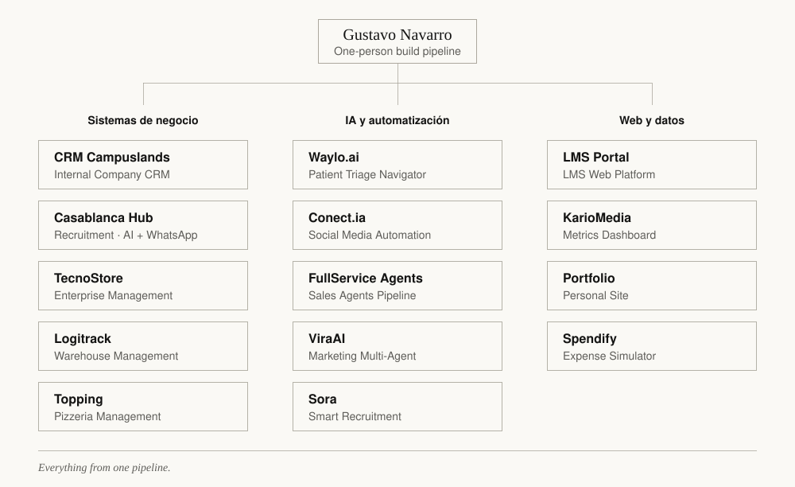</picture>
<picture><source media="(prefers-color-scheme: dark)" srcset="assets/dark/s03.svg"/></picture>
<picture><source media="(prefers-color-scheme: dark)" srcset="assets/dark/projects/01.svg"/></picture><a href="https://fullservices-crm.web.app/"><picture><source media="(prefers-color-scheme: dark)" srcset="assets/dark/projects/live.svg"/></picture></a><picture><source media="(prefers-color-scheme: dark)" srcset="assets/dark/projects/repo-private.svg"/></picture>
<picture><source media="(prefers-color-scheme: dark)" srcset="assets/dark/projects/02.svg"/></picture><a href="https://waylo-ai.vercel.app/"><picture><source media="(prefers-color-scheme: dark)" srcset="assets/dark/projects/live.svg"/></picture></a><a href="https://github.com/GustavoAdolfoNavarroPacheco/waylo.ai"><picture><source media="(prefers-color-scheme: dark)" srcset="assets/dark/projects/repo.svg"/></picture></a>
<picture><source media="(prefers-color-scheme: dark)" srcset="assets/dark/projects/03.svg"/></picture><a href="https://conectia-campuslands.vercel.app/"><picture><source media="(prefers-color-scheme: dark)" srcset="assets/dark/projects/live.svg"/></picture></a><a href="https://github.com/GustavoAdolfoNavarroPacheco/conect.ia"><picture><source media="(prefers-color-scheme: dark)" srcset="assets/dark/projects/repo.svg"/></picture></a>
<picture><source media="(prefers-color-scheme: dark)" srcset="assets/dark/projects/04.svg"/>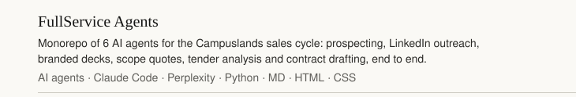</picture><picture><source media="(prefers-color-scheme: dark)" srcset="assets/dark/projects/live-none.svg"/>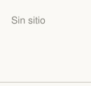</picture><a href="https://github.com/GustavoAdolfoNavarroPacheco/fullservice-agents"><picture><source media="(prefers-color-scheme: dark)" srcset="assets/dark/projects/repo.svg"/></picture></a>
<picture><source media="(prefers-color-scheme: dark)" srcset="assets/dark/projects/05.svg"/>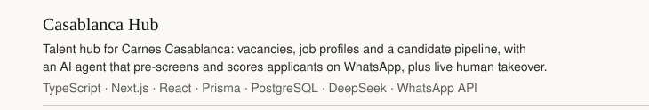</picture><a href="https://carnescasablanca.vercel.app/"><picture><source media="(prefers-color-scheme: dark)" srcset="assets/dark/projects/live.svg"/></picture></a><picture><source media="(prefers-color-scheme: dark)" srcset="assets/dark/projects/repo-private.svg"/></picture>
<picture><source media="(prefers-color-scheme: dark)" srcset="assets/dark/projects/06.svg"/></picture><a href="https://gustavoadolfonavarropacheco.vercel.app/"><picture><source media="(prefers-color-scheme: dark)" srcset="assets/dark/projects/live.svg"/></picture></a><picture><source media="(prefers-color-scheme: dark)" srcset="assets/dark/projects/repo-private.svg"/></picture>
<picture><source media="(prefers-color-scheme: dark)" srcset="assets/dark/projects/07.svg"/></picture><a href="https://gustavoadolfonavarropacheco.github.io/LMS_Portal/"><picture><source media="(prefers-color-scheme: dark)" srcset="assets/dark/projects/live.svg"/></picture></a><a href="https://github.com/GustavoAdolfoNavarroPacheco/LMS_Portal"><picture><source media="(prefers-color-scheme: dark)" srcset="assets/dark/projects/repo.svg"/></picture></a>
<picture><source media="(prefers-color-scheme: dark)" srcset="assets/dark/projects/08.svg"/>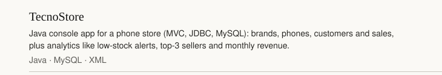</picture><picture><source media="(prefers-color-scheme: dark)" srcset="assets/dark/projects/live-none.svg"/></picture><a href="https://github.com/GustavoAdolfoNavarroPacheco/TecnoStore"><picture><source media="(prefers-color-scheme: dark)" srcset="assets/dark/projects/repo.svg"/></picture></a>
<picture><source media="(prefers-color-scheme: dark)" srcset="assets/dark/projects/09.svg"/>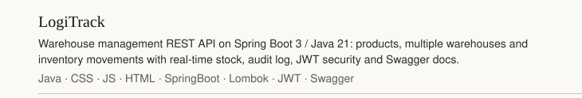</picture><a href="https://gustavoadolfonavarropacheco.github.io/Logitrack/frontend/"><picture><source media="(prefers-color-scheme: dark)" srcset="assets/dark/projects/live.svg"/></picture></a><a href="https://github.com/GustavoAdolfoNavarroPacheco/LogiTrack"><picture><source media="(prefers-color-scheme: dark)" srcset="assets/dark/projects/repo.svg"/></picture></a>
<picture><source media="(prefers-color-scheme: dark)" srcset="assets/dark/projects/10.svg"/>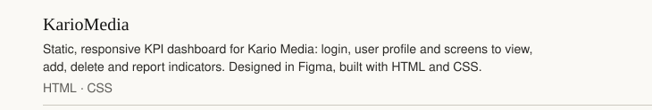</picture><a href="https://gustavoadolfonavarropacheco.github.io/KarioMedia/"><picture><source media="(prefers-color-scheme: dark)" srcset="assets/dark/projects/live.svg"/></picture></a><a href="https://github.com/GustavoAdolfoNavarroPacheco/KarioMedia"><picture><source media="(prefers-color-scheme: dark)" srcset="assets/dark/projects/repo.svg"/></picture></a>
<picture><source media="(prefers-color-scheme: dark)" srcset="assets/dark/projects/11.svg"/>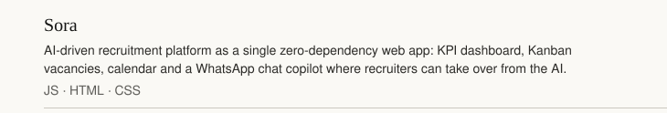</picture><a href="https://gustavoadolfonavarropacheco.github.io/Sora/"><picture><source media="(prefers-color-scheme: dark)" srcset="assets/dark/projects/live.svg"/></picture></a><a href="https://github.com/GustavoAdolfoNavarroPacheco/Sora"><picture><source media="(prefers-color-scheme: dark)" srcset="assets/dark/projects/repo.svg"/></picture></a>
<picture><source media="(prefers-color-scheme: dark)" srcset="assets/dark/projects/12.svg"/>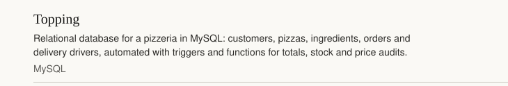</picture><picture><source media="(prefers-color-scheme: dark)" srcset="assets/dark/projects/live-none.svg"/></picture><a href="https://github.com/GustavoAdolfoNavarroPacheco/Topping"><picture><source media="(prefers-color-scheme: dark)" srcset="assets/dark/projects/repo.svg"/></picture></a>
<picture><source media="(prefers-color-scheme: dark)" srcset="assets/dark/projects/13.svg"/>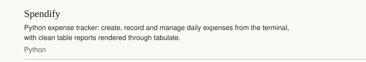</picture><picture><source media="(prefers-color-scheme: dark)" srcset="assets/dark/projects/live-none.svg"/></picture><a href="https://github.com/GustavoAdolfoNavarroPacheco/Spendify"><picture><source media="(prefers-color-scheme: dark)" srcset="assets/dark/projects/repo.svg"/></picture></a>
<picture><source media="(prefers-color-scheme: dark)" srcset="assets/dark/projects/14.svg"/>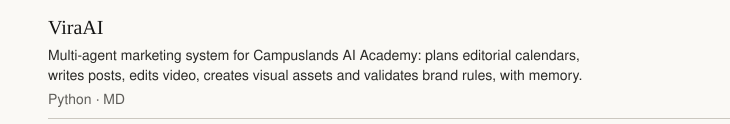</picture><picture><source media="(prefers-color-scheme: dark)" srcset="assets/dark/projects/live-none.svg"/></picture><a href="https://github.com/GustavoAdolfoNavarroPacheco/ViraAI-Agents"><picture><source media="(prefers-color-scheme: dark)" srcset="assets/dark/projects/repo.svg"/></picture></a>
<picture><source media="(prefers-color-scheme: dark)" srcset="assets/dark/s04.svg"/></picture>
<picture><source media="(prefers-color-scheme: dark)" srcset="assets/dark/telemetry.svg"/>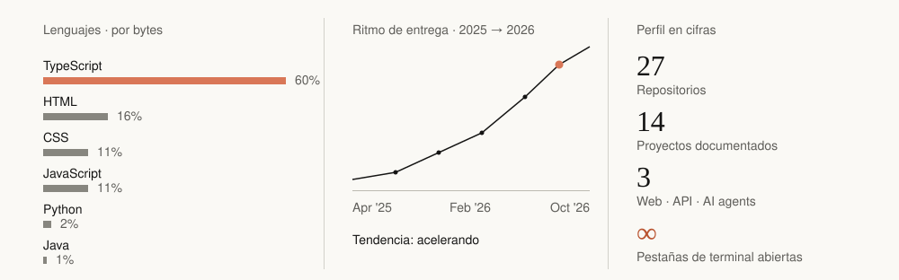</picture>
<picture><source media="(prefers-color-scheme: dark)" srcset="assets/dark/github-stats.svg"/></picture>
<picture><source media="(prefers-color-scheme: dark)" srcset="assets/dark/activity.svg"/>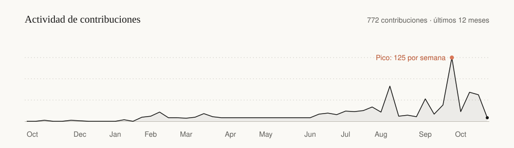</picture>
<picture><source media="(prefers-color-scheme: dark)" srcset="assets/dark/s05.svg"/>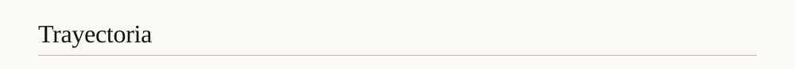</picture>
<picture><source media="(prefers-color-scheme: dark)" srcset="assets/dark/timeline.svg"/>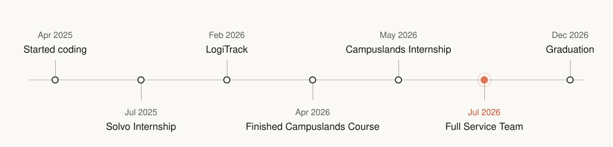</picture>
<picture><source media="(prefers-color-scheme: dark)" srcset="assets/dark/experience.svg"/>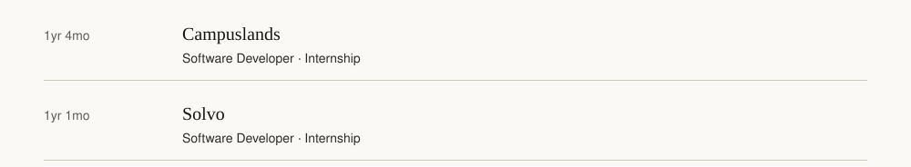</picture>
<picture><source media="(prefers-color-scheme: dark)" srcset="assets/dark/s06.svg"/>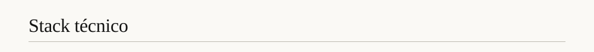</picture>
<picture><source media="(prefers-color-scheme: dark)" srcset="assets/dark/stack.svg"/>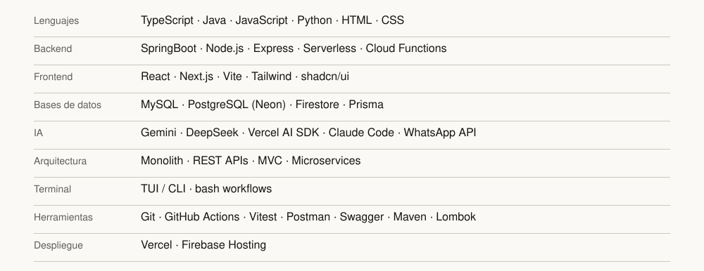</picture>
<picture><source media="(prefers-color-scheme: dark)" srcset="assets/dark/footer.svg"/></picture>

<!-- Generado con tools/build_assets.py: edita los datos allí y vuelve a ejecutarlo. -->
